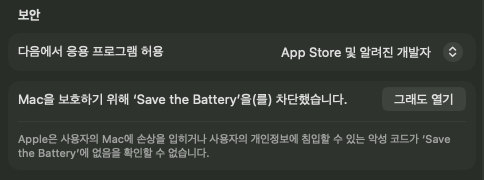

[English](README.md) · **한국어**

# Save the Battery

**노트북의 수명은 배터리가 좌우합니다. Save the Battery는 내 배터리를 더 오래 건강하게 지켜 주고, 다른 앱이 돈을 받는 기능도 여기서는 모두 무료입니다.**

무료 오픈소스(MIT) macOS 메뉴 막대 배터리 관리 앱입니다. 터미널로 오래 코딩할 때 쓰는 도구도 들어 있습니다.


```sh
curl -fsSL https://github.com/y-minion/savethebattery/releases/latest/download/install.sh | sh
```

**가장 먼저 할 일: 충전 상한을 80%로 맞추세요(Apple Silicon, macOS 26.4 이상).** 메뉴 창에서 충전 상한을 80%로 고르면, Save the Battery가 꺼져 있어도 macOS가 그 값에서 충전을 멈춥니다.

베타(0.2.0)입니다. 지금까지 Mac 한 대(M4 Pro, macOS 27.0.1)에서 테스트했습니다. 문제는 [이슈로 알려 주세요](https://github.com/y-minion/savethebattery/issues).

## 충전 상한이 왜 도움이 되나요

리튬 이온 셀은 높은 충전량으로 오래 있을수록, 거기에 열까지 더해지면 더 빨리 낡습니다. Apple도 이 때문에 충전 상한 기능을 안내하고([support.apple.com/102338](https://support.apple.com/102338)), Battery University가 스트레스 곡선을 설명합니다([BU-808](https://batteryuniversity.com/article/bu-808-how-to-prolong-lithium-based-batteries)). Save the Battery는 몇 개월, 몇 년 같은 숫자를 약속하지 않습니다. 대신 내 Mac에서 실제로 잰 값을 보여 줍니다. 충전량 90%·95% 이상으로 보낸 시간, 35 °C·40 °C 이상으로 보낸 시간, 사이클, 용량 기반 건강도 추정입니다. "상한이 80%였다면" 비교는 일반적인 리튬 이온 자료로 계산한 상대 스트레스 지수이며, 수명이 아닙니다.

## 다른 앱이 돈을 받는 기능, 여기서는 모두 무료

- **메뉴 막대 상태 아이콘:** 충전 중, 상한에서 대기, 과열 보류를 보여 줍니다. 아이콘+퍼센트, 아이콘만, 퍼센트만 중에서 고릅니다.
- **내 마음대로 바꾸는 메뉴 창:** 보여 줄 항목과 순서를 정합니다.
- **전력 흐름:** 어댑터 입력, 배터리 전력, Mac이 쓰는 전력. 읽을 수 없는 값은 추정하지 않고 숨깁니다.
- **하드웨어 잔량:** macOS 표시 값 옆에 배터리가 직접 보고한 잔량을 보여 줍니다.
- **충전 상한** 50~100%(80% 미만은 선택 헬퍼 필요)와 요일·시각별 **일정**.
- **한 번만 100% 충전**. 끝나면 정해 둔 상한으로 돌아갑니다.
- **과열 시 충전 보류:** 배터리가 뜨거우면 충전을 잠시 멈춥니다(선택, 앱 실행 중).
- **저전력 모드 스위치**와 **MagSafe LED 모드**("macOS 기본", "끄기", "상태별로 정하기"). 둘 다 선택 헬퍼가 필요합니다.
- **건강 기록과 실측 수치:** 이 Mac에만 저장하는 하루 단위 기록, 높은 충전량·고온 시간을 지난 기간과 비교, 사이클, 용량 기반 건강도 추정, 잠자기 중 소모, 제안. `stb health --json`으로 출력할 수 있습니다.
- **바이브 코딩 터미널 작업:** `claude`, `codex` 등 어떤 명령이든 `stb run`으로 감싸면 작업 동안 Mac이 잠들지 않습니다. 시간 제한과 화면 끄기를 고를 수 있습니다.
- **단축어 동작:** 충전 상한 설정, 한 번 완충 시작·종료, 상한 끄기, 저전력 모드 설정, 배터리 상태 가져오기.
- **알림:** 원하는 이벤트만 켜고, 같은 상황은 한 번만 알립니다.
- **한국어·영어 UI.** macOS 언어를 따릅니다.

## 지원 환경

| 내 Mac | 충전 상한·일정·한 번 완충·과열 보류·저전력 모드·MagSafe LED | 나머지 기능 |
|---|---|---|
| Apple 실리콘, macOS 26.4 이상 | 가능 | 가능 |
| Apple 실리콘, macOS 15~26.3 | macOS 26.4로 업데이트하면 가능 | 가능 |
| Intel, macOS 15 이상 | 지원 안 함 | 가능 |

앱은 유니버설 빌드입니다. 이전 macOS를 쓰는 Apple 실리콘 맥은 macOS를 26.4 이상으로 무료 업데이트하면 충전 상한을 쓸 수 있습니다. Intel 맥은 충전 기능을 뺀 나머지 기능을 씁니다. 자세한 내용은 [docs/COMPATIBILITY.md](docs/COMPATIBILITY.md)와 [docs/VALIDATION.md](docs/VALIDATION.md)에 있습니다.

## 설치

### 터미널 (경고창 없음)

```sh
curl -fsSL https://github.com/y-minion/savethebattery/releases/latest/download/install.sh | sh
```

스크립트는 macOS 버전을 확인하고, 같은 릴리스에서 `savethebattery.zip`과 체크섬을 받아 SHA-256을 검증한 뒤, sudo 없이 `/Applications`에 복사합니다. `curl`로 받은 파일에는 격리(quarantine) 표시가 붙지 않아 Gatekeeper 경고가 나오지 않습니다. 앱은 공증을 받지 않았으므로(공증은 유료 Apple 프로그램이 필요합니다), `sh`에 넘기기 전에 스크립트를 직접 읽어 보세요: [scripts/install.sh](scripts/install.sh).

### 브라우저로 내려받기

1. [최신 릴리스](https://github.com/y-minion/savethebattery/releases/latest)에서 `savethebattery.zip`을 받아 풀고 `Save the Battery.app`을 `/Applications`로 옮깁니다.
2. 한 번 엽니다. macOS가 앱을 확인할 수 없다고 안내합니다.
3. **시스템 설정 › 개인정보 보호 및 보안**을 열고 아래로 내려 Save the Battery 옆의 **그래도 열기**를 누른 뒤 확인합니다.



한 번만 하면 됩니다. 앱은 무료 Apple Development 인증서로 서명되어 서명 자체는 유효하고, 공증만 받지 않은 것입니다.

## 안전

- AlDente, batt, battery, Battery Toolkit이 설치되어 있거나 실행 중이면 Save the Battery는 아무것도 바꾸지 않습니다. 충전 관리 앱 둘이 같은 설정을 두고 다투면 안 되므로, 다른 앱을 먼저 종료하고 지워 주세요.
- 충전 상한은 macOS 기본 기능을 씁니다. 앱을 종료하거나 잠자기·재시동을 해도 유지되고, 시스템 설정에서도 확인할 수 있습니다.
- 앱이 시도한 충전 설정 쓰기를 최근 20건까지(시각·명령·요청 주체) `charge.json`에 기록합니다.
- SMC에는 MagSafe LED 키만 씁니다. 충전 관련 SMC 키는 쓰지 않습니다.

## 선택 헬퍼

80% 이상 상한, 일정, 한 번 완충은 추가 권한이 필요 없습니다. 80% 미만 상한, 저전력 모드 스위치, MagSafe LED에는 작은 루트 헬퍼가 필요합니다. 그런 기능을 고를 때만 앱 화면에서 macOS 관리자 암호 창으로 설치하며, 몰래 설치하지 않습니다.

- 정해진 요청만 받습니다: 상한 값 쓰기, 상태 읽기, 버전 읽기, 저전력 모드 전환, 네 가지 값 중 하나로 LED 설정. 셸을 실행하지 않고 SMC 키 하나(`ACLC`, 값 0·1·3·4)만 씁니다.
- 현재 로그인 사용자가 실행한 `/Applications/Save the Battery.app`의 요청만 받고, 공식 빌드는 서명 팀 `JQWWU7443A`로 고정됩니다. 직접 빌드한(임시 서명) 사본은 팀 고정이 없으며 그렇게 알려 줍니다.
- 프로토콜은 버전 3입니다. 0.1.x에서 헬퍼를 설치했다면 앱에서 한 번 다시 설치하세요.

자세한 내용은 [SECURITY.md](SECURITY.md)에 있습니다.

## 제거

```sh
curl -fsSL https://github.com/y-minion/savethebattery/releases/latest/download/uninstall.sh | sh
```

앱을 지우고, macOS 암호 창으로 헬퍼도 제거합니다(MagSafe LED는 macOS 제어로 돌아갑니다). 기록과 설정 삭제 여부(기본은 유지)를 묻습니다. 앱이 실행 중이면 macOS 충전 상한도 함께 끌지 묻고(기본은 유지), 그렇지 않으면 상한은 그대로 남으며 시스템 설정 › 배터리에서 바꿀 수 있습니다. 소스: [scripts/uninstall.sh](scripts/uninstall.sh).

## 소스에서 빌드

Xcode가 필요합니다. 프로젝트는 `project.yml`에서 [XcodeGen](https://github.com/yonaskolb/XcodeGen)으로 만들며, 고친 뒤에는 `xcodegen generate`를 실행하세요.

```sh
swift test --disable-xctest
python3 scripts/smoke-sessions.py .build/debug/stb
scripts/build-app.sh
open "dist/Save the Battery.app"
```

`scripts/build-app.sh`는 키체인의 "Apple Development" 인증서(또는 `STB_SIGN_IDENTITY`로 지정한 것)로 서명합니다. 인증서가 없으면 임시 서명을 하는데, 앱은 동작하지만 단축어 앱에 동작이 보이지 않고 헬퍼도 팀 고정이 되지 않습니다(직접 빌드한 사본). [CONTRIBUTING.md](CONTRIBUTING.md)를 참고하세요.

## 명령줄

앱이 실행 중이어야 합니다. `stb`는 같은 사용자만 쓸 수 있는 로컬 통로로 앱에 충전 설정을 요청합니다. 첫 줄은 `stb`를 셸 명령으로 만들며, 계속 쓰려면 `~/.zshrc`에 넣어 두세요.

```sh
alias stb="'/Applications/Save the Battery.app/Contents/MacOS/stb'"
stb charge set 70          # 50~100, 5 단위
stb charge off             # 상한 끄기
stb charge topup           # 한 번 100% 충전
stb charge end             # 완충 끝내기
stb charge status --json   # 앱 없이도 읽기 가능
stb health --json
stb run --hours 4 --screen-off -- claude
```

종료 코드: 0 성공, 1 실패 또는 결과 미확인, 2 사용법 오류, 3 앱이 실행 중이 아님. 작업의 잠자기 방지는 정한 시간이 지나거나 어댑터를 뽑으면 풀리며, 실행 중인 명령 자체는 종료하지 않습니다.

## 개인정보

원격 측정도 계정도 없습니다. 기록과 세션은 `~/Library/Application Support/savethebattery`에만 저장합니다. 네트워크 요청은 새 버전을 확인하려고 하루 한 번 `api.github.com`을 부르는 것뿐이며, 식별 정보는 보내지 않습니다. 설정에서 끌 수 있습니다. 네트워크 실패는 조용히 넘어가고, 자동으로 설치하는 것은 없습니다.

## 더 보기

설계와 계획은 [docs/superpowers](docs/superpowers)에 있습니다. 릴리스 노트: [docs/release-notes/0.2.0.md](docs/release-notes/0.2.0.md).

MIT · [라이선스](LICENSE) · [참고 프로젝트](THIRD_PARTY_NOTICES.md)
